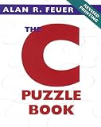
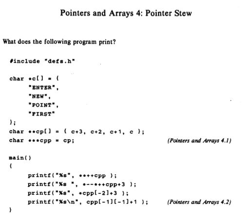
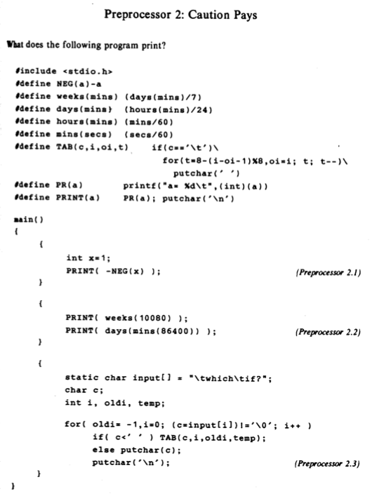
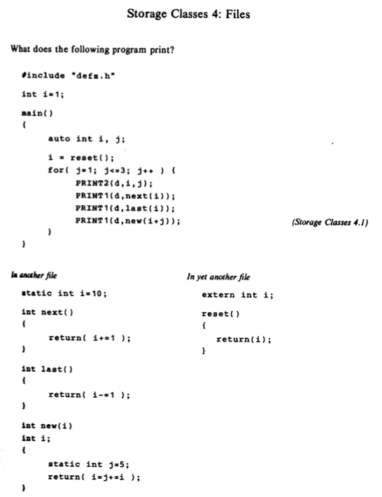

Feuer A., "The C puzzle book"

The first edition of this book was in 1982. Old code in C, which was considered to be "good" in the past, today quite often doesn't stand up to criticism (even though its criticising is a pointless exercise), but it's worth to study. 

I was extremely curious to have a look at puzzles in C created in eighteenth. So, fasten your seat belts. If The Hell in C exists, this is it. I've given a few "problems" from this book.

## Pointers

## Preprocessor

## Storage classes

For me, these snippets are obvious candidates for [Obfuscated C Code Context][]. When have to deal with such code in real life, switching to another reality is the the best solution.

[Obfuscated C Code Context]: http://www.ioccc.org

After skimming the book to the end (they give the solutions there), you begin to understand its usefulness. Without seeing bad code, it's difficult to recognize the good one.
