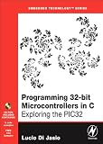
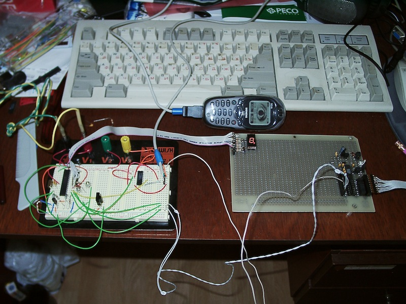

Working on [the interview with Geoff Graham][Interview with Geoff Graham], he told me about a book where he took a lot of inspiration and working code as well for the Maximite software.

<a href="https://www.amazon.co.uk/dp/B005VO36UG">Programming 32-bit Microcontrollers in C: Exploring the PIC32 (Embedded Technology)</a>

[Interview with Geoff Graham]: /blog/english/2012/08/07/interview-with-geoff-graham/

I stopped programming for PICs about ten year ago when we were developing a GSM phone based alarm system. We used the PIC16 chip and a DTFM decoder (be the way, the feature of controlling the alarm system dialing to it and using DTFM signals was pretty awesome that time) and a bunch of sensors.

I also worked with PIC12. I was stunned of just an 8-pin chip **programmable in C**!

Then I moved to the UK and left a lot of stuff at home. But recently it all has come back when I built [Maximite][] and [also bought][Raspberry Pi arrived] [Raspberry Pi][Raspberry Pi links]. Since then the technology has stepped forward, of course. Now PIC32 chips are based on the MIPS kernel, almost fully 32-bit and have a primitive virtual memory capabilities. It allows creating simple operating systems when the kernel has its own protected memory from users processes. For example, [RetroBSD perfectly works on Maximite][RetroBSD on Maximite].

[Maximite]: /blog/english/2012/01/19/maximite-kit/
[RetroBSD on Maximite]: /blog/english/2012/05/11/retrobsd-on-maximite/
[Raspberry Pi links]: /blog/english/2012/07/26/raspberry-pi-links/
[Raspberry Pi arrived]: /blog/english/2012/07/11/raspberry-pi-arrived/

Back to the book. I wanted to refresh my PIC knowledge and opened the book. To my surprise I swallowed it in a couple of evenings non-stop.

The book is organized perfectly and suitable for people having minimal experience in microcontrollers. But it covers serious topics such that:

* memory model
* interrupts (for example, timers or I/O)
* serial or parallel interfaces (for example, connecting to a LCD display or a PS/2 keyboard)
* ADC/DAC (for example, a temperature sensor or an analog joystick)
* generating black/white video signal (for example, composite or VGA) using non-trivial DMA-based data transfer for a memory buffer to the SPI channel
* SD/MMC cards interface
* implementation of the FAT
* sound generation via PWM

All example are complete and working. It can be even better if you have a companion CD of the book.

The only little issue was that the author used MPLAB and the C32 compiler (remember, the book was released in 2008), but Microchip strongly recommend migrating to MPLAB-X (which, by the way, the only choice for Linux and OSX) and the XC32 compiler based on GCC. Of course, the project files can be easily converted to the new MPLAB-X format, the book lacks examples of simple Makefiles. But it compensates it with exhaustive screenshots and commentaries about configuration windows, the debugger and the simulator. It is possible to read the book even without a computer.

If you read the book, you'll understand what can be implemented with PIC32 and how things work in it. If you decide to implement a project, you have enough examples plus understanding how to start the crystal.

**The conclusion**: Highly recommended.
