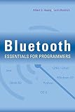

Продолжаю постепенно выкладывать на Google Code свои проекты.

На этот раз это эксперимент годовалой давности — удаленное управление для [Lego NXT][] через апплет, работающий на сотовом телефоне.

[Lego NXT]: http://www.mindstorms.ru/

Назвал незамысловато — [nxtbtrc][].

[nxtbtrc]: https://demin.ws/nxt/bluetooth/

Все просто — запускается на телефоне апплет, он спаривается с NXT и потом может посылать на него команды. В целом ничего сложного, просто было интересно разобраться как работать с синим зубом в апплетах. 

Врядли я там чего еще буду модифицировать, но может кому и пригодится.

Даже книжку, помню, для этого специально купил. Хорошая, кстати, книжка. Все доступно и понятно о bluetooth с точки зрения программиста. Рассмотрены несколько стеков разных производителей, их сравнение и использование на разных языках и платформах.

Albert Huang, Larry Rudolph, "Bluetooth Essentials for Programmers"

**Обновление**: Небольшое видео, демонстрирующее все в работе:



Посты по теме:

* [Хостинг на Google Code: SerialCom][]
* [Скрипты на Lua в С++][]

[Хостинг на Google Code: SerialCom]: /blog/russian/2009/06/07/googlecode-hosting-serialcom/
[Скрипты на Lua в С++]: /blog/russian/2009/06/12/lua-scripts-in-cpp/
