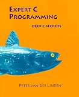

"Expert C Programming", Peter van der Linden

Случайно наткнулся где-то в твиттере на эту книгу. Несложный поиск дает множество вариантов c ней ознакомиться.

Покупать для себя я бы не стал. Для более менее опытного программиста на С тут нет ничего нового. Но, как всегда это бывает, имеет смысл за часик, под чай или кофе, пролистать и освежить в памяти разнообразные причуды указателей, моделей памяти (вечное здоровье сегментированной особым образом модели памяти родом из 8086 и 80286), ABI, особенности линковки в UNIX и Windows, ну и факты из истории языка и разнообразных его редакций.

В этой книге всего понемногу. 

P.S. Кстати, я думал, что знаю C потенциально лучше чем С++, просто потому, что язык объективно меньше и проще. Да и писать на нем я начал раньше. И решил я как-то сдать [тест по С][Brainbench C] на Брейнбенче. Оказывается, есть столько аспектов языка, которые я раньше просто не встречал. 

Понимаю, Брейнбенч - всего лишь тест, во многом далекий от реальности, но все равно позволяет расширить, так сказать, рамки понимания самого себя. 

[Brainbench C]: http://www.brainbench.com/xml/bb/common/testcenter/taketest.xml?testId=52