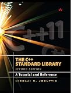

Nicolai M. Josuttis, "The C++ Standard Library: A Tutorial and Reference", 2nd edition

Yesterday the book had arrived. I wanted to write a proper detailed review, but realised it doesn't make sense at all. This is a must have book if you're interested in the new C++ 2011. The book is an exhaustive reference with a lot of examples of the new STL and the language itself. In my view, this is the first big C++ 2011 book at the moment.
