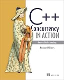

Довелось мне в этом году посетить [ACCU 2012][]. Практически все в этом году было про С++ 2011. Одна из презентаций, которые я посетил, была "C++11 concurrency tutorial" от [Антони Вильямса][Anthony Williams], не больше не меньше, мейнтейнера boost::thread.

[ACCU 2012]: http://accu.org/index.php/conferences/accu_conference_2012
[Anthony Williams]: http://www.boost.org/users/people/anthony_williams.html

Его презентация [доступна][C++11 concurrency tutorial slides] с [примерами][C++11 concurrency tutorial samples].

[C++11 concurrency tutorial slides]: http://www.justsoftwaresolutions.co.uk/files/c++11_concurrency.pdf
[C++11 concurrency tutorial samples]: http://www.justsoftwaresolutions.co.uk/files/c++11_concurrency_code.zip

Вторая его презентация, увы, которую я не посетил, называлась "Dataflow, Actors and High Level Structures in Concurrent Applications". Фактически, там было показано, как можно на С++ забацать actor'ы практически как в Эрланге.

Эта презентация тоже [доступна][Dataflow, Actors and High Level Structures in Concurrent Applications slides] с [примерами][Dataflow, Actors and High Level Structures in Concurrent Applications samples].

[Dataflow, Actors and High Level Structures in Concurrent Applications slides]: http://www.justsoftwaresolutions.co.uk/files/dataflow_and_actors.pdf
[Dataflow, Actors and High Level Structures in Concurrent Applications samples]: http://www.justsoftwaresolutions.co.uk/files/dataflow_and_actors_code.zip

Рекомендую.

Идем далее. Недавно вышла книга, "C++ Concurrency in Action" этого же автора (Anthony Williams).

Если хотите знать все про memory model в C++, почитайте пятую главу (и не только пятую).
