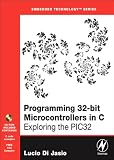
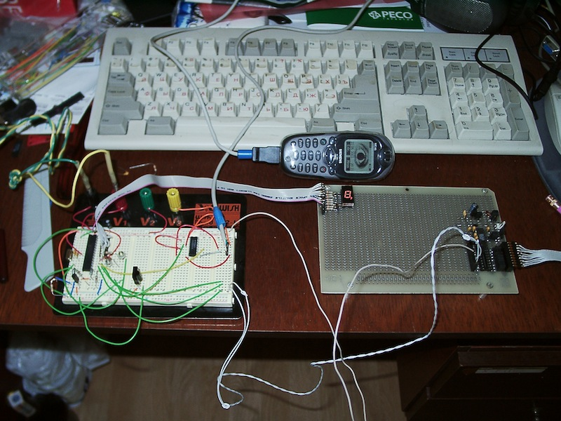

Работая с Джефом Грэхемом [над интервью][Интервью с Джефом Грэхемом], я узнал от него про книгу, идеи и готовые части кода из которой стали основой некоторых подсистем программой части Maximite.

<a href="https://www.amazon.co.uk/dp/B005VO36UG">Programming 32-bit Microcontrollers in C: Exploring the PIC32 (Embedded Technology)</a>

[Интервью с Джефом Грэхемом]: /blog/russian/2012/08/07/interview-with-geoff-graham/

Мой личный опыт с микроконтроллерами PICmicro закончился лет десять назад, когда с братом делами автомобильную сигнализацию на основе GSM телефона. В сердце был PIC16, DTFM декодер (уникальная, кстати на тот момент фича, когда можно было рулить сигнализацией, позвонив на ее номер и пикая с трубку циферьки) и датчики.

Потом было еще насколько проектов на PIC12. Меня реально перло, что микруху с несчастными восемью ногами можно **программировать**, на **С**!

Потом как-то все засохло. Я переехал, и многое из "добра" не взял с собой. Но вот недавно, после сборки [Maximite][Сборка Maximite] и [покупки][Raspberry Pi arrived] [Raspberry Pi][Raspberry Pi links], вся эта тема вернулась. Но время не стоит на месте, и современные PIC32 уже на ядре MIPS, все из себя 32-х битные, плюс с какой никакой виртуализацией адресов, что позволяет делать несложные операционные системы с разделением ядра и пользовательских процессов (например, RetroBSD, которая, кстати, 
[прекрасно работает на Maximite][RetroBSD на Maximite]).

[Сборка Maximite]: /blog/russian/2012/01/19/maximite-kit/
[RetroBSD на Maximite]: /blog/russian/2012/05/11/retrobsd-on-maximite/
[Raspberry Pi links]: /blog/english/2012/07/26/raspberry-pi-links/
[Raspberry Pi arrived]: /blog/english/2012/07/11/raspberry-pi-arrived/

Так вот, возвращаясь к книге. В желании освежить в памяти эту тему, я отрыл ее. К моему удивлению, я, не отрываясь, с удовольствием прочитал ее по диагонали за пару вечеров.

Книга очень грамотно построена и рассчитана на людей с минимальными знаниями о микроконтроллерах. Там даже есть экскурс в язык С для желающих. Начиная "от печки" в виде примитивных примеров с картинками и подробными объяснениями, автор постепенно раскрывает весьма недетский набор тем:

* модель памяти
* прерывания (например, для таймера или портов ввода/вывода)
* последовательные и параллельные интерфейсы (например, подключение LCD-экранчика или PS/2 клавиатуры)
* аналогово-цифровые и цифро-аналоговые преобразования (подключение, например, датчика температуры или джойстика для игры)
* генерация черно-белого видео сигнала (например, для композитного или VGA-сигнала) с небанальным использованием прямого доступа в память (DMA), кстати, еще одной модной примочки PIC32, для быстрого пропихивания битов из буфера в основной памяти в канал SPI
* работа SD/MMC картами
* реализация файловой FAT
* генерация звука через модуль ШИМ (PWM)

Все примеры законченные и работающие. Особенно будет удобно, если иметь диск от книги.

Одним небольшим неудобством было то, что автор использует среду MPLAB и компилятор С32 (все-таки книга вышла аж в 2008 году), а Microchip последнее время всех активно пересаживает на MPLAB-X, который есть не только для Windows, но и Linux и OSX, и компилятор XC32 на базе GCC. Хотя файлы проектов несложно импортируются в новую среду, в книге явно не хватает объяснений про элементарные makefile'ы. Но это компенсируется подробными картинками окон конфигурации, отладчика и симулятора. В принципе, книгу можно читать даже не имея компьютера под рукой.

Итак, проглядев книгу, вы будете понимать что и как возможно сделать на PIC32. А если решите собрать и запрограммировать реальный проект, у вас будет достаточно начального работающего кода и понимания, как запустить кристалл.

**Вывод**: настоятельно рекомендуемая книга. Кстати, вышла она не недавно, так что можно найти в хорошем PDF-ном качестве, хотя купив ее, вы негласно скажете автору спасибо.

