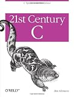

@language: russian
@date: 2012-11-30 22:00
@tags: book

"21st Century C: C Tips from the New School", автор Ben Klemens
================================================================

<a href="https://www.amazon.co.uk/dp/1449327141">21st Century C: C Tips from the New School</a>

Как следует из названия - это книга о "новом" C. Конкретно: С89, C99 и даже
C11. Плюс, краткий обзор основных "игроков" типа gcc или clang.

Скажу сразу, что это не учебник, а сборник советов автора на тему 
использования возможностей современного C.

Зацените начало введения: 

*C has only a handful of keywords and is a bit rough around the edges, and it rocks. You can do anything with it. Like the C, G and D chords of a guitar, you can learn the basic mechanics pretty quickly, and then spend the rest of your life getting better*.

Мне понравилось. А когда я увидел главу под названием "C syntax you can
ignore", точно решил с книгой ознакомиться.

Итак, сначала идет небольшой обзор стандартов. Затем пара глав про утилиты
и средства разработки (gdb, autotools, makefiles, valgrind, git). Кратко,
но для новичков это будет началом, где копнуть. Далее идет, собственно,
про язык. Дается много полезных советов про указатели, структуры (понятно, что
для "нового" С), приемчики объектно-ориентированного подхода, работа с
Unicode. В конце обзор нескольких распространенных библиотек.

Книга выглядит немного поверхностно, но на одно вечернее чтиво тянет
спокойно.

Например, что лично нового узнал для себя:

* ключевое слово "restrict"
* функция "asprintf()", которая сама выделяет нужное место для буфера
* идея префикса "private_" для членов структур, доступ к которым надо
  ограничить (физической защиты не дает, конечно, но является удобной
  подсказкой)

Также, например, если надо из функции вернуть несколько значений, можно
просто использовать struct в качестве результата функции. Если размер
структуры небольшой, то все будет и красиво и быстро. Не то, чтобы я этого 
не знал, но просто в С это не самый распространенный прием, и часто о нем 
забываешь.

Как всегда бескомпромиссный совет использовать makefile вместо пачки скриптов.

Но книга была бы пресной без "ЧТО?! - НИКОГДА!!!".

Например, автор поддерживает использование goto для экстренного выхода из
функции, когда в ее конце есть код завершения, который надо обязательно
выполнить. Лично я так никогда делать не буду, а постараюсь изолировать
этот код, например, в отдельной функции, и вызывать ее на каждом подобном
выходе.

Также автор рекомендует не использовать switch в целом, объясняя это его
ненаглядным синтаксисом и проблемой пропущенного break. Опять, лично я с
этим не могу согласиться.

Далее автор всячески рекомендует autotools (autoconf, automake, libtools).
Лично до сих пор не могу до конца понять суть этих сложных и запутанных
систем. Хорошо, когда скрипт "configure" уже кем-то написан, но делать
его самому...

Под занавес - doxygen. Крайне редко я видел проекты, где автоматическая
документация реально хорошего качества. Увы, поддержание doxygen'овских
вставок в достойном состоянии - это отдельный фронт работы, на который
обычно нет ни желания, ни времени, если, конечно, это документация не
является коммерческой частью продукта.

**Вывод**: Можно купить книгу в офис, по очереди пролистать за вечером, и
затем можно перетирать детали на офисной кухне с коллегами.

